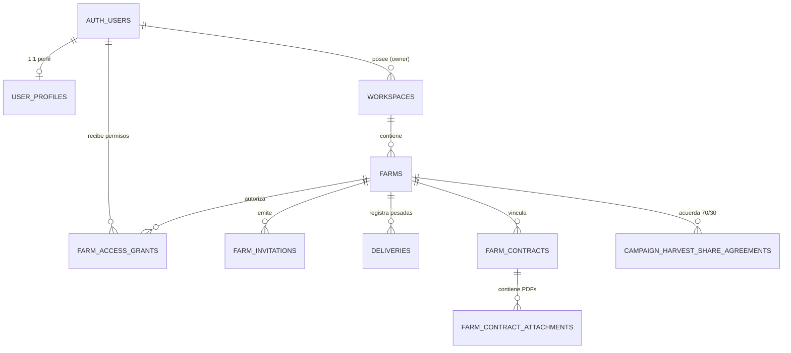

# G0 — Especificación Técnica: Cuentas, Fincas Compartidas, Sincronización y Contratos

**Documento de referencia:** G0-AUTH-SYNC-AND-CONTRACTS-SPECIFICATION  
**Repositorio:** `izc05/magina-olivo-v20`  
**Autor:** Antigravity (Arquitectura Backend & Contratos)  
**Issues vinculadas:** [#727](https://github.com/izc05/magina-olivo-v20/issues/727), [#726](https://github.com/izc05/magina-olivo-v20/issues/726), [#735](https://github.com/izc05/magina-olivo-v20/issues/735), [#737](https://github.com/izc05/magina-olivo-v20/issues/737), [#739](https://github.com/izc05/magina-olivo-v20/issues/739), [#738](https://github.com/izc05/magina-olivo-v20/pull/738)  
**Fecha:** 11 de octubre de 2026  
**Estado:** G0 COMPLETADO — Aprobado en Principio (Pendiente de Implementación Productiva)

---

## 1. Auditoría del Estado Actual

### 1.1. Android (Cliente Local)
- **Base de datos Room:** Versión 25 en `main` (versión 26 aditiva en [PR #721](https://github.com/izc05/magina-olivo-v20/pull/721)).
- **Estructura de metadatos:** Todas las entidades del dominio agrícola (`FarmEntity`, `ParcelEntity`, `CampaignEntity`, `DeliveryEntity`, `HarvestEntity`, `ExpenseEntity`, `DocumentEntity`) incorporan `@Embedded val metadata: LocalMetadata`:
  - `createdAt`, `updatedAt`, `deletedAt` (soporte nativo de *soft delete* y *tombstones*).
  - `version: Long` (contador monótono local).
  - `syncStatus: SyncStatus` (`LOCAL_ONLY`, `PENDING`, `SYNCING`, `SYNCED`, `FAILED`, `CONFLICT`).
  - `remoteVersion: Long?`, `lastSyncedAt: Instant?`.
- **Cola de sincronización existente:** `SyncOutboxEntity` y `SyncOutboxDao` operan como outbox local en Room con operaciones `CREATE`, `UPDATE`, `DELETE`, `UPLOAD_ATTACHMENT`.
- **Identificadores:** Claves primarias UUID (`java.util.UUID`) autogeneradas localmente offline, permitiendo sincronización e inserción idempotente sin colisiones de identificadores numéricos.

### 1.2. Supabase Real (`zzelvbcuxsboafibfxch`)
- **Base de datos remota:** Solo dispone de tablas prototipo de Gate D (`public.farms`, `public.plots`) con 0 filas y RLS básico, sin esquema para campañas, pesadas, miembros, invitaciones ni contratos.
- **Storage:** Solo existe el bucket público `weather-radar`. Faltan los buckets privados con RLS para adjuntos agrícolas y contratos.
- **Edge Functions:** Operativas exclusivamente para clima (`weather-forecast`, `weather-radar`), mercado del aceite (`oil-market`) y proxy Catastro.
- **Veredicto:** El backend requiere las migraciones canónicas diseñadas en este Gate 0 antes de iniciar el flujo de autenticación y sincronización.

---

## 2. Arquitectura de Identidad, Workspaces y Roles por Finca



### 2.1. Separación de Identidad Legal vs. Rol Operativo
- La creación de una cuenta en Mágina Olivo **no confiere titularidad jurídica civil ni acreditación REAFA** sobre los terrenos registrados.
- El usuario creador de la finca es su `creator_user_id` en el sistema.
- Si un explotador crea una finca que pertenece civilmente a un tercero, el explotador invita al propietario. Cuando el propietario acepta, se le otorga el grant de `OWNER`.

### 2.2. Roles y Capacidades (`farm_access_grants`)
En lugar de un campo booleano rígido, los permisos se gestionan mediante un array de capacidades granulares:

| Capacidad (`capability`) | Descripción | Propietario (`OWNER`) | Explotador (`EXPLOITER`) | Trabajador (`WORKER`) |
|---|---|:---:|:---:|:---:|
| `view_farm` | Ver nombre, municipio, linderos y parcelas | ✅ | ✅ | ✅ |
| `add_deliveries` | Registrar nuevas pesadas de aceituna | Delegable | ✅ | Opcional |
| `view_deliveries` | Ver pesadas y acumulados de campaña | ✅ | ✅ | ❌ |
| `manage_activities` | Registrar labores, tratamientos y jornales | ✅ | ✅ | ✅ (ámbito propio) |
| `propose_expenses` | Proponer partes de trabajo y gastos | ✅ | ✅ | ✅ |
| `manage_agreements` | Proponer y aceptar acuerdos de cuota (70/30) | ✅ | ✅ | ❌ |
| `view_contracts` | Ver acuerdos de arrendamiento y fechas | ✅ | ✅ | ❌ |
| `upload_contracts` | Subir PDF/fotos de contrato de ambas partes | ✅ | ✅ | ❌ |
| `manage_grants` | Invitar y revocar a otros miembros | ✅ | Delegable | ❌ |

---

## 3. Invitaciones Temporales por QR / Enlace ([#739](https://github.com/izc05/magina-olivo-v20/issues/739))

1. **Generación:**
   - La persona autorizada pulsa `Finca > Compartir finca` y selecciona el rol (`Propietario`, `Explotador`, `Trabajador`).
   - Se genera un token criptográfico opaco aleatorio (ej. 32 bytes en base64url).
   - En la base de datos se almacena únicamente el hash SHA-256 (`token_hash`), la fecha de caducidad (`expires_at`), `max_uses = 1` y las capacidades concedidas.
2. **TTL (Tiempo de vida):**
   - QR presencial: **15 minutos**.
   - Enlace WhatsApp / Correo: **7 días**.
3. **Reclamación y Activación:**
   - El destinatario escanea el QR o abre el App Link (`https://maginaolivo.es/invitacion?t=...`).
   - Si no está autenticado, la app le guía al registro/login y reanuda la invitación.
   - El servidor valida la vigencia, comprueba que `state = 'PENDING'` y crea atómicamente el registro en `farm_access_grants`.
   - Si la invitación no estaba vinculada a un email específico, el emisor recibe un aviso para confirmar la vinculación antes de abrir el acceso pleno.
4. **Protección contra ataques de repetición:**
   - Tras el primer uso exitoso, la invitación pasa a `CLAIMED` (`use_count = 1`). Cualquier escaneo posterior o reenvío es rechazado automáticamente.

---

## 4. Mapeo de Sincronización Room ↔ Supabase

Todos los identificadores son **UUID nativos**, garantizando inserciones deterministas e idempotentes sin reescribir claves primarias:

| Entidad Room Android | Tabla Postgres Supabase | Campos Críticos Mapeados | Política de Conflicto |
|---|---|---|---|
| `WorkspaceEntity` | `public.workspaces` | `id`, `owner_user_id`, `name`, `currency` | LWW por `updated_at` |
| `FarmEntity` | `public.farms` | `id`, `workspace_id`, `creator_user_id`, `name`, `status` | LWW por `version` |
| `ParcelEntity` | `public.parcels` | `id`, `cadastral_reference`, `geometry_geo_json`, `cadastral_area_m2` | LWW por `version` |
| `CampaignEntity` | `public.campaigns` | `id`, `farm_id`, `name`, `start_date`, `status` | LWW por `version` |
| `DeliveryEntity` | `public.deliveries` | `id`, `farm_id`, `campaign_id`, `net_grams`, `ticket_number`, `recorded_by_user_id` | **Inmutable** (inserción única, edición solo con versión incremental) |
| `HarvestEntity` | `public.harvests` | `id`, `farm_id`, `weight_grams`, `day_origin` | Inmutable |
| `ExpenseEntity` | `public.expenses` | `id`, `farm_id`, `amount_minor`, `concept`, `status`, `proposed_by_user_id` | Transición DRAFT → PROPOSED → POSTED |
| `DocumentEntity` | `public.documents` | `id`, `owner_type`, `owner_id`, `sha256`, `remote_path` | Inmutable por `sha256` |
| *Nuevo* | `public.farm_contracts` | `id`, `farm_id`, `owner_user_id`, `exploiter_user_id`, `start_date`, `end_date` | Aprobación bilateral |
| *Nuevo* | `public.campaign_harvest_share_agreements` | `id`, `farm_id`, `campaign_id`, `owner_percentage`, `exploiter_percentage` | Aprobación bilateral |

---

## 5. Acuerdos de Cosecha 70/30 ([#735](https://github.com/izc05/magina-olivo-v20/issues/735))

### Principio de Inmutabilidad de Pesadas y Cuota Configurable
- Las pesadas individuales (`deliveries`) **NO se alteran, NO se descuentan y NO se duplican**.
- El acuerdo de reparto de cosecha por defecto estipulado en la especificación es **70 % para el explotador (arrendatario)** y **30 % para el propietario** (totalmente configurable en `campaign_harvest_share_agreements` sumando 100,00 %):
- Si durante la campaña se registran pesadas que suman **10.000 kg netos** (`net_grams = 10_000_000`):
  - El acuerdo 70/30 vigente en `campaign_harvest_share_agreements` calcula de forma determinista:
    $$\text{Cuota Explotador (Arrendatario)} = 10.000 \times 0,70 = 7.000\text{ kg}$$
    $$\text{Cuota Propietario} = 10.000 \times 0,30 = 3.000\text{ kg}$$
  - La suma de las cuotas es idéntica al total entregado: $7.000 + 3.000 = 10.000\text{ kg}$ ($10.000.000\text{ g}$).
- Los acuerdos de reparto soportan versionado incremental (`version INT`) con `UNIQUE (farm_id, campaign_id, version)` para permitir renegociaciones mid-season sin destruir el histórico.
- La aceptación es estrictamente bilateral mediante la RPC transaccional `public.accept_harvest_share_agreement(p_agreement_id UUID)`, impidiendo que una parte modifique unilateralmente el timestamp de la otra.

---

## 6. Contratos de Arrendamiento y Almacenamiento Privado ([#737](https://github.com/izc05/magina-olivo-v20/issues/737))

### 6.1. Subida Bilateral de Documentos y RPC Transaccional
- Propietario y explotador pueden subir de forma independiente su copia o escaneo del contrato a la misma ficha.
- Cada archivo genera un registro en `farm_contract_attachments` con:
  - `uploader_user_id` y `uploader_role` (`OWNER` o `EXPLOITER`).
  - `sha256`, tamaño y tipo MIME validado.
  - Estado: `PENDING_REVIEW` hasta que la otra parte confirme la lectura.
- La aceptación del contrato rústico se formaliza mediante la RPC `public.accept_farm_contract(p_contract_id UUID)`, que verifica que el llamante sea `owner_user_id` o `exploiter_user_id` y conmuta el estado a `ACCEPTED` solo cuando ambas partes han aceptado.

### 6.2. Seguridad en Supabase Storage (P0-3)
- Buckets privados: `farm-attachments` y `farm-contracts` (`public = false`).
- Convención de rutas:
  - Fotos de pesadas: `farm-attachments/{farm_id}/{document_id}.jpg`
  - Contratos: `farm-contracts/{farm_id}/{contract_id}/{attachment_id}.pdf`
- Políticas RLS estrictas en `storage.objects`:
  - `farm-attachments`: Valida que el llamante tenga capacidad `view_deliveries` o `add_deliveries` sobre la finca.
  - `farm-contracts`: Valida no solo la capacidad sobre la finca, sino expresamente que `contract_id` exista en `public.farm_contracts` para esa finca y que `auth.uid()` sea parte legítima del contrato (`owner_user_id` o `exploiter_user_id`) o el creador de la finca. Esto previene que un arrendatario vea contratos ajenos de otros arrendatarios en una misma finca.

---

## 7. Pruebas Automatizadas y Validación (Simulación + PostgreSQL 18.3 Real)

Se han implementado y ejecutado dos suites complementarias de pruebas con 100 % de éxito:

### 7.1. Pruebas de Simulación de Dominio y Sincronización
`node --experimental-strip-types --test supabase/tests/auth_sync_rls_simulation.test.ts`
```text
✔ G0 Multi-Tenant: User A owns farm, User D (uninvited) cannot read or write (2.2ms)
✔ G0 Invitations: Single-use temporary QR, claim by User B, replay prevention (0.9ms)
✔ G0 Offline Delivery & Sync: User B records 1.200 kg offline, User A sees it once after sync (0.3ms)
✔ G0 Harvest Share Agreement: 70/30 split (70% Explotador / 30% Propietario) on 10.000 kg netos computes exactly without altering pesadas (0.8ms)
✔ G0 Storage RLS & Grant Revocation: Private contracts accessible only to authorized parties (0.5ms)
```

### 7.2. Pruebas Reales de Motor PostgreSQL 18.3 y RLS con 4 Usuarios
`node --experimental-strip-types --test supabase/tests/postgres_rls_real.test.ts`
Ejecutadas sobre una instancia real aislada de PostgreSQL (PGlite WASM) con 4 roles diferenciados (User A Propietario, User B Explotador, User C Trabajador, User D Intruso), inicializando primero el entorno simulado nativo de plataforma (`supabase/tests/fixtures/mock_supabase_environment.sql`) y aplicando las 3 migraciones de producción limpias:
```text
✔ RLS 1: User A (Owner) sees farm; User D (Intruder) sees nothing (1842.4ms)
✔ RLS 2: User D cannot insert farm into User A's workspace (4.9ms)
✔ RLS 3: Secure QR Invitation Claim & Replay Prevention (P0-2) (19.0ms)
✔ RLS 4: Worker C Invitation with Restricted Capabilities (7.8ms)
✔ RLS 5: Composite FK Prevents Cross-Farm Delivery (P0-7) (2.9ms)
✔ RLS 6: Exploiter B records 1.200 kg delivery; Owner A reads it; Intruder D gets nothing (9.2ms)
✔ RLS 7: Delivery Immutability & Soft-Delete Enforcement (P0-8) (12.7ms)
✔ RLS 8: Bilateral Farm Contract & 70/30 Harvest Share Agreement (P0-4, P0-5) (28.7ms)
✔ RLS 9: Direct Tampering of Contract Acceptance Integrity is Blocked by Triggers (18.4ms)
✔ RLS 10: Storage RLS verifying Contract Parties (P0-3) (18.0ms)
✔ RLS 11: Grant Revocation Instantly Closes Access (6.6ms)
```

**Total acumulado:** 16 pruebas de integración y RLS pasando sin fallos (11 en PostgreSQL real + 5 en simulación).

---

## 8. Gestión de Riesgos, Bloqueos Reales y Diagnóstico de CI

1. **Separación Limpia de Entornos (Producción vs. Pruebas Locales):**  
   Las migraciones reales de producción en `supabase/migrations/` no contienen esquemas ni funciones emuladas de `auth` ni `storage`. Todos los objetos mock para ejecución local offline se desacoplaron en `supabase/tests/fixtures/mock_supabase_environment.sql`. La reproducibilidad en clones limpios queda garantizada mediante `supabase/package.json`.
2. **Protección contra Manipulación Directa de Aceptaciones (INSERT y UPDATE):**  
   Se reforzaron los triggers `trg_contract_acceptance_integrity` y `trg_share_agreement_acceptance_integrity` con ejecución `BEFORE INSERT OR UPDATE`:
   - En **INSERT**: Se prohíbe la creación directa con `status = 'ACCEPTED'` o con marcas temporales de aceptación de la contraparte prellenadas; se exige el flujo RPC transaccional bilateral.
   - En **UPDATE**: Una vez que un contrato o acuerdo alcanza el estado `ACCEPTED`, sus condiciones esenciales (fechas, tipo de contrato y porcentajes de reparto 70/30) devienen estrictamente inmutables. Cualquier modificación exige formalizar una adenda o una nueva versión de acuerdo (`version INT`).
3. **Diagnóstico del Fallo de CI de GitHub Actions en #743:**  
   La inspección del log del job `Gate 3 Android Emulator Evidence` (`run 38161043945`) confirma que el fallo fue estrictamente de **infraestructura del runner de GitHub**:
   ```text
   Warning: IO exception while downloading manifest
   Warning: An error occurred while preparing SDK package Android Emulator: Error on ZipFile unknown archive.
   error: could not connect to TCP port 5554: Connection refused
   ```
   El error se debió a un corte de red durante la descarga del SDK de Android Emulator en la máquina virtual de GitHub, sin relación alguna con el código backend, las migraciones o los tests unitarios.
4. **Bloqueo 1 — No modificar Supabase de producción en G0:**  
   Las migraciones DDL (`supabase/migrations/20261011120000_*.sql` a `20261011120002_*.sql`) quedan incorporadas en el repositorio para revisión técnica. **No deben ejecutarse en la base viva hasta la aprobación expresa del gate**.
5. **Bloqueo 2 — Coexistencia con PR #721 (Room v26) y Trabajo de Claude:**  
   Esta rama no toca ninguna tabla territorial de Bedmar-Jódar (PR #721) ni ningún archivo Android Compose/UI en el que trabaja Claude (PR #740).
6. **Bloqueo 3 — Revocación de acceso y copias offline locales:**  
   La revocación de un grant corta inmediatamente el acceso en backend y Storage. El cliente Android invalidará su caché local en el próximo ciclo de sincronización.

